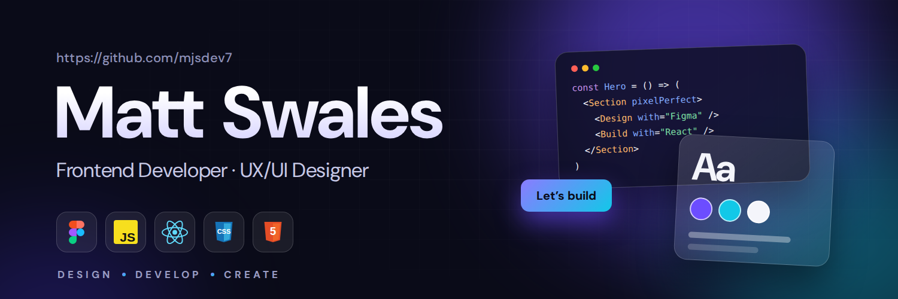

  

<h2 align="center">Hi there, I'm Matt! </h2>

  I'm a full-stack developer and UX/UI designer who enjoys bringing ideas to life through design and code.
   
  I focus on building clean, modern web applications and intuitive user experiences.

---

<h3 align="center">TECH STACK</h3>

  

---

<h3 align="center">FEATURED PROJECTS</h3>

<table>
  <tr>
    <td width="50%">
      <h3 align="center"> Meal-Navi</h3>
      
A meal planning and grocery shopping application designed to make everyday cooking easier.

      
<a href="https://github.com/mjsdev7/Meal-Navi">View Project →</a>

    </td>
    <td width="50%">
      <h3 align="center"> Camp-Navi</h3>
      
A camping discovery platform helping people explore campsites across Japan.

      
<a href="https://github.com/mjsdev7/campnavi">View Project →</a>

    </td>
  </tr>
</table>

---

<h3 align="center">GITHUB STATISTICS</h3>

  
  

  

---

<h3 align="center">LET'S CONNECT</h3>

  <a href="mailto:m.j.swales@hotmail.com">EMAIL</a>

